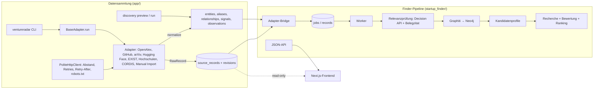
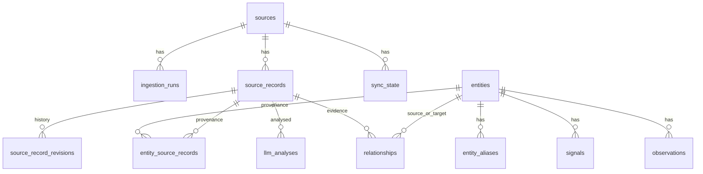

# StartUp-Finder

> Build a sourcing engine that spots upcoming startups from the traces they leave long before their funding round.

StartUp-Finder erkennt potenzielle Start-ups und frühe Gründungsvorhaben anhand öffentlicher Spuren aus Forschung, Hochschulen, Förderprojekten, Open Source und frühen Unternehmensaktivitäten und macht sie nachvollziehbar prüfbar. Im Mittelpunkt stehen belegbare Hinweise mit Herkunft, nicht möglichst viele Datensätze.

Das Repository ist ein **Team-Prototyp (MVP)**, keine fertige öffentliche Mehrbenutzerplattform. Bewertungen und Scores sind Recherchehilfen, keine Anlageempfehlung und keine HTGF-Investitionsentscheidung.

`ventureradar`, `VentureRadar-Ingestion` und die Paket-/Tabellennamen sind historische technische Bezeichnungen; Produktname ist **StartUp-Finder**.

## Inhalt

1. [Überblick und Umsetzungsstand](#überblick-und-umsetzungsstand)
2. [Repository-Aufbau](#repository-aufbau)
3. [Architektur](#architektur)
4. [Setup](#setup)
5. [Datensammlung (Collector)](#datensammlung-collector)
6. [Early-Signal-Discovery](#early-signal-discovery)
7. [Finder-Pipeline: API, Worker und Knowledge Graph](#finder-pipeline-api-worker-und-knowledge-graph)
8. [Frontend](#frontend)
9. [Förderung, Eigenkapital und Finanzmodell](#förderung-eigenkapital-und-finanzmodell)
10. [HTGF-Bewertung (offline)](#htgf-bewertung-offline)
11. [LLM-Allowlist (Ingestion-Seite)](#llm-allowlist-ingestion-seite)
12. [Daten-Artefakte](#daten-artefakte)
13. [Datenbankschema](#datenbankschema)
14. [Datenqualität, Datenschutz und Recht](#datenqualität-datenschutz-und-recht)
15. [Fehlerbehandlung](#fehlerbehandlung)
16. [Neue Quelle hinzufügen](#neue-quelle-hinzufügen)
17. [Tests](#tests)
18. [Bekannte Grenzen](#bekannte-grenzen)
19. [Weitere Dokumentation](#weitere-dokumentation)

## Überblick und Umsetzungsstand

| Baustein | Inhalt | Stand |
|---|---|---|
| **Datensammlung** (`app/`, CLI `ventureradar`) | Öffentliche bzw. manuell bereitgestellte Quellen erfassen, normalisieren und mit Provenienz in PostgreSQL (Neon) speichern | Implementiert für `openalex`, `arxiv`, `github`, `huggingface`, `exist`, `university`, `cordis`, `manual_import`; Live-Verifizierung quellenabhängig |
| **Early-Signal-Discovery** (`app/discovery/`) | Deterministische Einordnung gespeicherter Signals/Observations und begrenzte Text-Erwähnungsregeln | Implementiert und getestet; keine Startup-Klassifikation |
| **Finder-Pipeline** (`startup_finder/`) | Adapter-Bridge, Relevanzprüfung, Graphiti/Neo4j-Knowledge-Graph, Kandidatenprofile, Recherche, Bewertung, Ranking, JSON-API | Prototyp; benötigt PostgreSQL, Neo4j und OpenAI; keine Exactly-once-Garantie |
| **Frontend** (`frontend/`) | Next.js-Oberfläche für Kandidaten, Shortlist, Suchaufträge, Quellen, Pipeline, Graph sowie read-only Datenbestandsansicht | Prototyp; spricht ausschließlich mit der Finder-API (außer `/datenbestand`) |
| **Finanzmodell** (`app/finance/`, `app/evidence/`) | Förderung und externes Eigenkapital getrennt modellieren und konservativ bewerten | Offline-Modelle und Tests; **keine Persistenz in Neon** |
| **HTGF-Bewertung** (`app/htgf/`) | Kuratierte Kandidaten-Evidenz gegen drei HTGF-Kriterien prüfen | Offline, dateibasiert, ohne DB/LLM/Netzwerk |
| **LLM-Allowlist** (`app/llm/`) | Freigabeprüfung, Evidenzvalidierung, Fake Provider für synthetische Daten | Deny-by-default; keine echte Provider-Integration auf Ingestion-Seite |
| **Pitch** (`pitch/`) | Pitch-Video mit synthetischen Demodaten | Separates Hilfsprojekt |

Wichtige Abgrenzungen:

* Die Collector-Daten sind **keine** Startup-Liste. Gespeicherte Organisationen können bereits finanziert sein und werden nicht automatisch als Startup klassifiziert. `EntityType.STARTUP` ist nur ein Typwert.
* Es gibt **keine globale Entity Resolution** auf Collector-Ebene: Entities sind quellenbezogen und werden nie über Quellen oder gleiche Namen hinweg zusammengeführt. Die Finder-Pipeline gleicht Identitäten nur innerhalb des Graphiti-Graphen ab (Modell-Extraktion und Decision-Routen), nicht in den Collector-Tabellen.
* Förderungen (EXIST, CORDIS, Zuschüsse, Stipendien, Preise) sind **keine** Eigenkapitalrunden. `NEW_FUNDING_PROJECT` und `FUNDED_BY` beschreiben Förder- bzw. Projektkontext.
* Fehlende Treffer beweisen nie, dass keine Finanzierung oder kein Unternehmen existiert.

## Repository-Aufbau

| Pfad | Inhalt |
|---|---|
| `app/cli.py` | Typer-CLI `ventureradar`: `collect`, `database`, `ingestion`, `discovery`, `llm`, `htgf` |
| `app/adapters/` | Collector, Registry, Hochschul-Connectoren und Plugins |
| `app/config/` | Runtime-Einstellungen, `search_terms.yaml`, `sources.yaml`, `llm_allowlist.yaml` |
| `app/database/` | SQLAlchemy-Modelle, Repository, Verbindung, Alembic-Migrationen |
| `app/discovery/` | Deterministische Signal-/Observation-Klassifikation und Textregeln |
| `app/evidence/` | Gemeinsame Modelle für Quelle, Dokument, Claim, Evidenz und Zitatvalidierung |
| `app/finance/` | Finanzereignisse, Equity-Feststellungen und Equity-Bewertung |
| `app/htgf/` | Offline-HTGF-Bewertung mit append-only Historie |
| `app/llm/` | Allowlist, Autorisierung, Analyse-Schema, Fake Provider, Runner |
| `app/http/`, `app/ingestion/`, `app/normalization/`, `app/utils/` | HTTP-Client, Pydantic-Typen, Normalisierung, Hilfsfunktionen |
| `startup_finder/` | Finder-API, Worker, Store, Adapter-Bridge, Graphiti-Clients, Ontologie, Kandidaten, Ranking, Rebuild |
| `frontend/` | Next.js-16-/React-19-Frontend |
| `data/candidates/` | Punktuelle Kandidatenanalyse (Stand 2026-11-20) und HTGF-Ein-/Ausgaben |
| `data/exports/` | Pilot-Exporte für Knowledge Graph und Finanzen |
| `docs/` | Architektur, API-Vertrag, Signal-Vertrag, LLM-Allowlist, Finanzmodell, HTGF, Pilot-Handoff, Ontologie |
| `pitch/` | Skript, Szenen und Rendering des Pitch-Videos |
| `scripts/` | Einstiegsskripte (`run_collector.py`, `initialize_database.py`) und ein einmaliges Pilot-Skript |
| `tests/` | Adapter-, Discovery-, Finance-, HTGF-, LLM-, HTTP-, DB-, Integrations- und Normalisierungstests |

## Architektur



**Datensammlung:** `app/adapters/base.py` orchestriert `fetch → Rohdaten speichern → normalize → validate → normalisiert speichern`. Rohdaten werden zuerst geschrieben (jeder Datensatz in eigenem Savepoint), alle Schreibvorgänge sind Upserts auf Unique-Constraints, Läufe sind dadurch idempotent. Spätestens nach 50 Datensätzen wird committet.

**Finder-Pipeline:** Die Adapter-Bridge liest Collector-`source_records` samt verknüpften Normalisierungen read-only und reiht Verarbeitungsjobs ein. Der Worker prüft die Relevanz, extrahiert mit Graphiti ein `StartupVenture` und dessen direkte Beziehungen in Neo4j, materialisiert Kandidatenprofile in PostgreSQL und löst Recherche und Bewertung aus. Details: [docs/architecture.md](docs/architecture.md).

## Setup

Voraussetzungen: Python 3.12+, Docker (lokale Test-Datenbank), Node.js (Frontend), ein Neon-Projekt für Produktivdaten. Für die Finder-Pipeline zusätzlich Neo4j und ein OpenAI-Zugang.

```powershell
# virtuelle Umgebung außerhalb von OneDrive halten
python -m venv C:\Users\<you>\venvs\startup-finder
C:\Users\<you>\venvs\startup-finder\Scripts\python.exe -m pip install -r requirements.txt
# optional: Finder-Pipeline mit Graphiti
C:\Users\<you>\venvs\startup-finder\Scripts\python.exe -m pip install -e ".[live,dev]"

Copy-Item .env.example .env        # danach lokal befüllen, nie committen
docker compose up -d               # lokales PostgreSQL 16 auf Port 5433 (Tests / Fallback)
python -m app.cli database status
```

`python -m app.cli database init` führt `alembic upgrade head` aus und wendet alle Revisionen an (aktuell `0001` Basisschema, `0002` `llm_analyses`). **Nie ungeprüft gegen Neon ausführen.**

### Konfiguration (`.env`)

`.env` ist git-ignored. Secrets werden nur aus der Umgebung gelesen, nie im Code oder in der Datenbank gespeichert. Variablennamen stehen in [.env.example](.env.example).

| Variable | Benötigt für | Hinweise |
|---|---|---|
| `DATABASE_URL` | Collector, Discovery, LLM, Finder | Collector-CLI und Finder nutzen diesen Wert. `postgresql://` wird für Collector automatisch auf psycopg 3 umgeschrieben. |
| `DATABASE_URL_DIRECT` | Alembic | Nicht gepoolte Neon-URL; Alembic fällt sonst auf `DATABASE_URL` zurück. Collector nutzen sie **nicht** – für Collector-Läufe gegen das Direct-Ziel muss `DATABASE_URL` entsprechend gesetzt werden. |
| `TEST_DATABASE_URL` | DB-Tests | Nur eine entbehrliche Datenbank (z. B. Docker, `127.0.0.1:5433`). Tests löschen das `public`-Schema. |
| `GITHUB_TOKEN` | `github` | Token mit öffentlichem Lesezugriff |
| `OPENALEX_API_KEY` | `openalex` (empfohlen) | Ohne Key gilt ein knappes, geteiltes Tagesbudget und Basic-Paging bis 10.000 Ergebnisse |
| `HF_TOKEN` | `huggingface` (optional) | Öffentliche Endpunkte funktionieren ohne Token |
| `CONTACT_EMAIL` | empfohlen, für UDE Pflicht | Wird im `User-Agent` gesendet |
| `MANUAL_IMPORT_DIR` | `manual_import` | Standard `data/manual_imports/`, git-ignored |
| `HTTP_TIMEOUT_SECONDS`, `HTTP_MAX_RETRIES`, `LOG_LEVEL`, `LOG_FORMAT`, `OBSERVATION_BUCKET` | Collector | Laufzeitparameter |
| `HOST`, `PORT`, `API_TOKEN`, `CORS_ORIGINS`, `APP_MODE` | Finder-API | `API_TOKEN` ist Pflicht, wenn `HOST` kein Loopback ist; `APP_MODE` fehlt oder ist `live` |
| `OPENAI_API_KEY`, `OPENAI_MODEL` | Finder-Worker | Pflicht für den Finder-Start |
| `NEO4J_URI`, `NEO4J_USER`, `NEO4J_PASSWORD`, `NEO4J_DATABASE` | Finder | Pflicht für den Finder-Start |
| `GRAPHITI_GROUP_ID`, `GRAPHITI_CLIENT_FACTORY`, `GRAPHITI_TELEMETRY_ENABLED`, `SEMAPHORE_LIMIT` | Finder | Graphiti-Konfiguration |
| `DECISION_PROVIDER`, `OPENAI_DECISIONS_MODEL`, `JEV_API_KEY`, `JEV_MODEL` | Finder (optional) | `off`, `openai` oder `jev`; fehlende Unterstützung führt zu einem Fehler, nicht zu einem stillen Fallback |
| `POSTGRES_USER`, `POSTGRES_PASSWORD`, `POSTGRES_DB` | `compose.yml` | Lokaler Finder-Stack |

### Docker-Varianten

| Datei | Zweck |
|---|---|
| `docker-compose.yml` | Entbehrliche Test-/Entwicklungsdatenbank für Collector (PostgreSQL 16, Port `5433`, `ventureradar_test`) |
| `compose.yml` | Lokales PostgreSQL (Port `5432`) und Neo4j (`7474`/`7687`) für die Finder-Pipeline |
| `compose.app.yml` | Ergänzt `api` und `worker`: `docker compose -f compose.yml -f compose.app.yml up --build` |
| `Dockerfile` | Image für Finder-API/Worker (`python -m startup_finder serve`) |

## Datensammlung (Collector)

```powershell
python -m app.cli collect openalex --limit 10 --dry-run
python -m app.cli collect github --limit 20 --dry-run
python -m app.cli collect university --source ude_forschung --limit 5 --dry-run
python -m app.cli collect cordis --limit 5 --dry-run
python -m app.cli collect manual_import --dry-run
python -m app.cli collect all
python -m app.cli database status
python -m app.cli ingestion history --limit 10 --source github
```

Die installierte CLI heißt `ventureradar`; `python -m app.cli` ist gleichwertig.

* `--limit N` begrenzt die Datensätze; ein limitierter Lauf schreibt keine Cursor fort.
* `--dry-run` ruft Quelle und Normalisierung auf, schreibt aber nichts und braucht keine Datenbank.
* `--source` ist nur bei `university` erlaubt (Quell-Key oder Gruppe).
* stdout enthält JSON (ein `RunResult` je Collector), Logs gehen als JSON-Zeilen nach stderr (`LOG_FORMAT=text` für Menschen).

| Exit-Code | Bedeutung |
|---|---|
| 0 | erfolgreich |
| 10 | partiell: einzelne Datensätze fehlgeschlagen, Rest gespeichert |
| 1 | fehlgeschlagen (bereits gespeicherte Daten bleiben) |
| 2 | Konfigurationsfehler (unbekannter Collector, fehlender Token / `DATABASE_URL`) |
| 3 | Datenbank nicht erreichbar |

### Collector-Übersicht

Jeder Collector läuft eigenständig, inkrementell (Cursor in `sync_state`, nur nach vollständig erfolgreichem Lauf fortgeschrieben), paginiert und rate-limit-bewusst (Tenacity, `Retry-After`). Suchbereiche stehen in `app/config/search_terms.yaml` und `app/config/sources.yaml`.

| Collector | Zugriff | Verhalten und Felder | Grenzen |
|---|---|---|---|
| `openalex` | REST `/works` | Werke mit deutschen Institutionsbezügen nach Themen. ID, Titel, Abstract (aus invertiertem Index), Datum, Autor:innen + IDs, Institutionen (ROR), Topics, Keywords, DOI; Zitationszahl als Observation. Max. 100 Autor:innen je Werk. | Cursor nach Publikationsdatum mit 7-Tage-Lookback; spät indexierte ältere Werke können fehlen. Daten CC0. |
| `github` | REST + Search | Repository-Suche nach Topics in 7-Tage-Fenstern (automatisches Splitten), README, Contributors, Commits/Issues/PRs (nur IDs und Daten, **keine E-Mails oder Git-Autorennamen**). Bekannte Repositories werden mit ETags erneut beobachtet. | Benötigt `GITHUB_TOKEN`; Search mit 2,1 s Abstand; Wartezeiten > 5 min brechen ab. Kein Länderfilter, keine Discussions. |
| `arxiv` | Atom-API | Kategorien, oldest-first; ID, Titel, Abstract, Autor:innen, Daten, Kategorien, DOI, PDF-**URL** (PDFs werden nicht gespeichert). | 1 Anfrage / 3 s; max. 1.000 Ergebnisse pro Lauf; kein Länderfilter, keine stabilen Autoren-IDs. |
| `huggingface` | Hub-API | Modelle, Datensätze, Spaces, optional Model Cards (max. 20.000 Zeichen), Namespaces als Organisation/Nutzer, öffentliche Mitglieder (nur Handles). Observations: Downloads, Likes. | Bisher nur mit Mocks/Fixtures verifiziert, siehe [Bekannte Grenzen](#bekannte-grenzen). |
| `exist` | Sitemap + WordPress-REST (Daten) + HTML | Erfolgsgeschichten und Programmseiten. | Programmbezüge sind Keyword-Treffer und `UNVERIFIED` `FUNDED_BY`; keine strukturierten Förderdaten, keine Personen. |
| `university` | RSS, validierte Sitemap + JSON-LD, JSON-LD, Page-Metadata, CSS-Selektoren | Explizit konfigurierte Quellen, kein Crawling. Aktiv: `kit`, `tu_darmstadt`, `ude_forschung`. | Robots-Prüfung je Abruf; Nicht-RSS mind. 10 s pro Host. Siehe [UDE](#universität-duisburg-essen-ude). |
| `cordis` | Öffentlicher EURIO-SPARQL-Endpunkt (nur `SELECT`) | EU-Projekte mit Beteiligten aus konfigurierten Ländern (Standard `DE`): `research_project` mit `NEW_FUNDING_PROJECT`, Beteiligte als `organization` mit `PARTICIPATED_IN`. | 10 s Abstand, 25 Projekte pro Seite, max. 1.000 pro Lauf, 60-Tage-Overlap; CC BY 4.0, Attribution „© European Union, CORDIS“. Kein Fallback-Endpunkt. |
| `manual_import` | Lokale CSV/JSON-Dateien, **kein Netzwerk** | Personen und Unternehmen (`person`, `organization`, `WORKS_AT`, standardmäßig `unverified`). | Max. 5 MB / 5.000 Zeilen; LinkedIn-URLs nur syntaktisch geprüft, nie geöffnet. Dauerhaft von LLM-Verarbeitung ausgeschlossen. |

`foerderdatenbank.de`, Fraunhofer, Max-Planck, DLR, GEPRIS, HTGF, Bundesanzeiger u. a. werden wegen Robots-Regeln oder ungeklärter Nutzungsbedingungen **nicht** gesammelt (Befunde vom 2026-11-20, siehe [AGENTS.md](AGENTS.md)). Öffentliche Abrufbarkeit ist keine Wiederverwendungserlaubnis.

### CORDIS

* Konfiguration: `sources.yaml` → `cordis` (`countries`, `initial_days`, `lookback_days`, `page_size`, `max_projects_per_run`). Nur Beteiligte aus den konfigurierten Ländern werden gespeichert.
* Cursor: Projektstartdatum plus Skip-Zähler, damit ein begrenzter Lauf innerhalb eines Datums fortsetzen kann.
* CORDIS liefert keinen feineren Organisationstyp; `organization_type` bleibt generisch `organization`.
* CORDIS-Projekte sind öffentliche Forschungsförderung, keine Startup-Finanzierungsrunden.

### Manual Import

Dateien in `MANUAL_IMPORT_DIR` ablegen und `python -m app.cli collect manual_import [--dry-run]` ausführen.

* Spalten/Keys: `linkedin_url`, `name` (Pflicht); `position`, `company`, `project_affiliation`, `verification_status` (`unverified` oder `manually_verified` mit `verification_method` und `checked_at`), `notes`, `row_id`. Unbekannte Spalten führen zur Ablehnung.
* Eine Datei mit einer ungültigen Zeile wird vollständig abgelehnt und nach `failed/` verschoben (mit `.problems.txt`, das nur Zeilen und Felder nennt); der Lauf ist `partial`.
* Erfolgreich importierte Dateien gehen nach `processed/` (neutraler Name). Aufbewahrung: `processed` 30 Tage, `failed` 14 Tage.
* Logs enthalten nie Namen, Firmen, URLs oder Notizen. Tests verwenden nur synthetische Daten.

### Universität Duisburg-Essen (UDE)

| Key | Quelle | Connector / Art | Status |
|---|---|---|---|
| `ude_forschung` | `https://www.uni-due.de/rss/forschung.rss` | `rss` / `news` | **aktiv** |
| `ude_aktuell` | `https://www.uni-due.de/rss/aktuell.rss` | `rss` / `news` | deaktiviert |
| `ude_guide` | `https://www.uni-due.de/guide/` + validierte Sitemap (nur `/guide/`) | `page_metadata` / `organization_unit` | deaktiviert |

* `ude_aktuell` und `ude_guide` bleiben deaktiviert, bis Nutzungsbedingungen geklärt sind (keine Bedingungen für automatisierte Wiederverwendung gefunden; `robots.txt` sperrt `GPTBot`). Eine deaktivierte Quelle auszuwählen endet mit Exit-Code 2.
* Gespeichert: Titel, Link, Datum, Teaser (max. 500 Zeichen), Feed-Metadaten als Provenienz. **Nicht** gespeichert: Volltexte, Enclosures, Bilder, Autor:innen.
* `CONTACT_EMAIL` ist Pflicht; Anfragen an `www.uni-due.de` mindestens 10 s auseinander; Erstabruf max. 90 Tage.
* Sitemaps werden vor Nutzung validiert; die geprüfte Sitemap listete genau 5.000 URLs und wirkt gekappt, ist also kein vollständiger Seitenindex.

Zeitstempel werden nie vermischt: `published_at` ist das Datum in der Quelle, `event_date` das reale Ereignis (oft `NULL`), `first_seen_at` die erste Erfassung, `created_at`/`updated_at` sind DB-Buchhaltung. Alles in UTC; Unbekanntes bleibt `NULL`.

## Early-Signal-Discovery

Discovery liest nur bereits gespeicherte Daten und macht keine Netzwerkanfragen.

```powershell
python -m app.cli discovery preview --limit 100                  # read-only
python -m app.cli discovery preview --source github --limit 100
python -m app.cli discovery run --source university --limit 100  # schreibt abgeleitete Erwähnungs-Signals
```

* Adapter-Signals (`NEW_PUBLICATION`, `NEW_REPOSITORY`, `NEW_MODEL`, `NEW_FUNDING_PROJECT`, `NEW_CONTRIBUTOR`, `NEW_PRESS_RELEASE`, …) werden klassifiziert, nicht dupliziert. Ein Repository ist kein Startup, ein gefördertes Projekt keine Equity-Runde.
* Einzelne Observations gelten als schwache Aktivitätsindizien; ein Einzelwert ist kein Trend.
* Versionierte Textregeln erzeugen nur `FOUNDING_ACTIVITY_MENTION`, `SPINOUT_MENTION` und `COMMERCIALIZATION_MENTION` – lexikalische Treffer, keine bestätigten Fakten. `event_date` wird nicht aus dem Publikationsdatum abgeleitet.
* Regel-ID/-Version, Feld, Treffer und Quellverweis stehen in `signals.properties`; wiederholte Läufe sind idempotent.

Details: [docs/phase2-signal-contract.md](docs/phase2-signal-contract.md).

## Finder-Pipeline: API, Worker und Knowledge Graph

Die Finder-Pipeline (`startup_finder/`) baut aus Collector-Daten Kandidatenprofile und einen Knowledge Graph. Sie läuft ausschließlich im Produktivmodus und startet nur mit PostgreSQL-`DATABASE_URL`, Neo4j und `OPENAI_API_KEY`.

```powershell
python -m startup_finder init-db        # legt Finder-Tabellen (records, jobs, leases, schema_version) an
python -m startup_finder serve          # JSON-API, Standard http://127.0.0.1:8000
python -m startup_finder worker         # Queue, Relevanzprüfung, Graphiti, Recherche, Bewertung
python -m startup_finder sync-adapters --source exist --record-type success_story --limit 1 --dry-run
python -m startup_finder sync-adapters --source exist --record-type success_story --limit 1
python -m startup_finder rebuild-graph --group-id startup_finder_de_ontology_v1
```

**Achtung:** Jeder dieser Befehle – auch `sync-adapters --dry-run` – initialisiert zuerst die Finder-Tabellen in der unter `DATABASE_URL` konfigurierten Datenbank. Diese Tabellen werden nicht über Alembic verwaltet. Ein Lauf ohne `--dry-run` reiht Jobs ein; der Worker löst anschließend kostenpflichtige OpenAI-, Embedding- und Graphiti-Aufrufe aus.

Ablauf:

1. **Adapter-Bridge:** liest `source_records` mit Revisionen, Entities, Aliasen, Beziehungen, Signals und Observations read-only und erzeugt Finder-Fundstellen. Nur Datensätze mit HTTP(S)-URL, Titel und verwertbarem Text werden übernommen. Der Worker pollt neue Adapterdatensätze automatisch im 60-Sekunden-Takt.
2. **Relevanzprüfung:** Die Decision-Route bewertet jeden Datensatz; nur relevante Datensätze werden vom generativen Modell auf einen konkret benannten Venture-Kandidaten mit wörtlichem Belegzitat geprüft. Allgemeine Publikationen und Programme bleiben Neon-Quellbelege, werden aber nicht in den Graph übernommen.
3. **Knowledge Graph:** Graphiti schreibt in Neo4j nach dem Vokabular in [docs/startup-sourcing-ontology.ttl](docs/startup-sourcing-ontology.ttl) (Ventures, Personen, Organisationen, Produkte, Technologien, Märkte, Investoren, Finanzierungsrunden, Programme, Standorte, Kennzahlen). Die API liest eine materialisierte Teilansicht in PostgreSQL.
4. **Recherche und Bewertung:** Jeder neue Kandidat löst Recherche (Produkt, Team, Standort, Markt, Finanzierungsrunden/Investoren) und Bewertung aus. Funding gilt nur als bestätigt, wenn ein Zitat in einem abgerufenen Originaldokument verifiziert wurde; `not_found` heißt nur „in den durchsuchten Quellen kein Beleg“.
5. **Ranking:** Vier Kriterien, gleich gewichtet; mindestens drei müssen mit Belegreferenzen bewertet sein. Die Gewichtung ist eine unvalidierte Startversion.

API-Endpunkte und Datenformate: [docs/frontend-contract.md](docs/frontend-contract.md). Suchaufträge sammeln konfigurierte Quellen; der Prompt wird nur als Kontext gespeichert – eine semantische Suche ist nicht implementiert.

## Frontend

```powershell
cd frontend
npm ci
npm run dev      # http://localhost:3000
npm run check    # Typecheck + Build
```

Die Oberfläche spricht über `frontend/src/finder/api/client.ts` mit der Finder-API (Standard `http://localhost:8000`, `CORS_ORIGINS` muss `http://localhost:3000` enthalten). Produktdaten werden erst angezeigt, wenn die API `live` meldet; es gibt keine Mock-API. Auf Loopback ist kein Token nötig, bei Netzwerkbindung verlangt das Backend `API_TOKEN`.

`/datenbestand` ist eine separate technische Ansicht, die Collector-Daten serverseitig in Read-only-Transaktionen aus Neon liest (Entities, Beziehungen, Fundstellen, Läufe). Für Deployments eine Datenbankrolle ohne Schreibrechte verwenden. Details: [frontend/README.md](frontend/README.md).

## Förderung, Eigenkapital und Finanzmodell

`app/finance/` trennt Förderung strikt von externem Eigenkapital ([docs/financial-support-and-equity.md](docs/financial-support-and-equity.md)):

* `FinancialSupportEvent` beschreibt ein kuratiertes Ereignis mit Kategorie (Zuschuss, Stipendium, Forschungsförderung, Preis, Equity, Angel/VC, Darlehen, Wandelinstrument, Sachleistung, sonstige, unbekannt), Status, Betrag mit Qualifier (`exact`, `up_to`, `approximate`), Rollen (Antragsteller, Empfänger, Geldgeber) und den Merkmalen `dilutive`/`repayable` (`yes`/`no`/`unknown`). Jede Angabe trägt Provenienz mit exakt validiertem Zitat.
* `assess_equity` liefert getrennt davon:
  * `equity_confirmed` – nur mit expliziter Equity-Feststellung, Beleg und **dokumentierter menschlicher Prüfung**; unterscheidet `completed` von `binding_agreement`.
  * `no_public_equity_round_found` – nur nach dokumentierter, menschlich geprüfter Recherche über Unternehmens-, Register-, Investoren- und Medienquellen; **kein** Beweis, dass keine private Finanzierung existiert.
  * `equity_status_unclear` – alle übrigen Fälle.
* Eine Kategorie wie „Venture Capital“ allein ergibt keinen Equity-Befund. Eine eigene Kategorie für Spenden sowie Felder für erworbene Anteile oder Beteiligungsquoten gibt es nicht.
* **Persistenz:** Finanzereignisse und Equity-Bewertungen werden **nicht** in Neon-Tabellen gespeichert. Für vier Pilotfälle (OnSite, nodeline, Floronics, deepset) liegen sie in [data/exports/pilot_finance.json](data/exports/pilot_finance.json) und verweisen auf Neon-Entity- und Source-Record-IDs. Alle vier Bewertungen sind `equity_status_unclear`; bei deepset ist die berichtete 30-Mio.-USD-Runde (2023) erfasst, ein menschlich geprüfter Equity-Befund fehlt.

## HTGF-Bewertung (offline)

Bewertet manuell kuratierte Kandidaten-Evidenz gegen drei HTGF-Kriterien (Technologie, Unternehmensalter, Deutschlandbezug). Kein Datenbankzugriff, keine Online-Recherche, kein LLM, keine Investitionsentscheidung.

```powershell
python -m app.htgf            # oder: python -m app.cli htgf run
```

Eingabe `data/candidates/htgf_input.json`; Ausgaben `htgf_assessments.json` (append-only Historie), `htgf_overview.csv`, `htgf_research_report.md`. Details: [docs/htgf-assessment.md](docs/htgf-assessment.md).

## LLM-Allowlist (Ingestion-Seite)

`app/llm/` prüft vor jeder Analyse eine Source-/Field-Allowlist ([app/config/llm_allowlist.yaml](app/config/llm_allowlist.yaml), `default_policy: deny`, derzeit leer) und validiert, dass jede Evidenz wörtlich in einem kuratierten Feld vorkommt.

```powershell
python -m app.cli llm preview --limit 100   # read-only Freigabeprüfung
python -m app.cli llm run --limit 100       # schreibt in llm_analyses; nur synthetische Quellen, lokaler Fake Provider
```

Es gibt hier keine echte Provider-Integration; reale Quelldaten und `manual_import` sind blockiert. Ergebnisse landen in `llm_analyses` (Migration `0002`). Diese Sperre gilt für die Ingestion-Seite; die Finder-Pipeline nutzt OpenAI unabhängig davon über eigene Konfiguration. Details: [docs/phase2b4-llm-allowlist.md](docs/phase2b4-llm-allowlist.md).

## Daten-Artefakte

| Datei | Inhalt |
|---|---|
| `data/candidates/candidate_discovery.json`, `candidate_validation.json`, `candidate_overview.csv`, `candidate_research_report.md` | Punktuelle Kandidatenanalyse aus einem Neon-Snapshot vom 2026-11-20: 8 Kandidaten aus EXIST-Erfolgsgeschichten mit getrenntem Company- und Funding-Status und regelbasiertem Recherche-Score (0–10). Kein wiederholbarer Code-Workflow und keine Anlagebewertung. |
| `data/candidates/htgf_*` | Ein- und Ausgaben der HTGF-Bewertung |
| `data/exports/knowledge_graph_pilot.json` | Aus Neon gelesene Pilot-Entities, Beziehungen und Source Records (Quelle `manual_pilot_research`) |
| `data/exports/pilot_finance.json` | Pilot-Finanzereignisse, Evidenz, Equity-Feststellungen und -Bewertungen |

Herkunft, Zählerstände und SQL-Beispiele des Piloten: [docs/knowledge-graph-handoff.md](docs/knowledge-graph-handoff.md).

## Datenbankschema

Alle Primärschlüssel sind UUIDs, alle Zeitstempel `timestamptz` (UTC). Collector-Tabellen werden über Alembic verwaltet (`app/database/migrations/`).



| Tabelle | Zweck |
|---|---|
| `sources` | Quelle, Typ, Basis- und Terms-URL; identifiziert über `source_name` |
| `ingestion_runs` | Ein Eintrag pro Lauf: Status, Zähler, Fehler |
| `source_records` | **Original-Payloads** (JSONB), Hash, `published_at`, `first_seen_at`, `last_seen_at`; eindeutig je `(source_id, external_id)` |
| `source_record_revisions` | Vorherige Payloads bei inhaltlicher Änderung |
| `entities` | Normalisierte Entities (13 Typen), JSONB-Properties |
| `entity_aliases` | Namen, URLs, ORCID/ROR/DOI und quellenbezogene Identifier |
| `entity_source_records` | Provenienz Entity ↔ Quell-Datensatz |
| `relationships` | Typisierte Kanten mit `verification_status` (`source_asserted`, `unverified`, `manually_verified`) und Pflicht-`source_record_id` |
| `signals` | Ereignisse mit Quelle und Zeitbezug, eindeutig je Entity, Typ und Datensatz |
| `observations` | Zeitreihen (Stars, Downloads, Zitationen …), gebucktet nach `OBSERVATION_BUCKET` |
| `sync_state` | Cursor und ETags je Quelle und Abfragebereich |
| `llm_analyses` | Versionierte LLM-Analyseversuche (Migration `0002`) |

Die Finder-Pipeline nutzt zusätzlich eigene, nicht migrierte Tabellen (`records`, `jobs`, `leases`, `schema_version`) und Neo4j. Volatile Felder erzeugen keine Revisionen; ihre Historie liegt in `observations`.

## Datenqualität, Datenschutz und Recht

1. Rohdaten werden nie durch normalisierte Daten überschrieben; alles verweist über `entity_source_records` / `source_record_id` zurück.
2. Unbekannte Werte bleiben `NULL`; keine erfundenen Daten, Länder, Gründer oder Finanzierungen.
3. Gleichnamige Personen werden nie zusammengeführt; Schreibvarianten von Organisationen sind Aliase.
4. Beziehungen nur, wenn die Quelle sie nennt, sonst als `unverified` markiert.
5. Wiederholte Läufe erzeugen keine Duplikate; Fehler lassen gespeicherte Daten intakt.

* Nur öffentliche, quellenattribuierte Daten; kein LinkedIn-Scraping, keine privaten Profile.
* Datenminimierung: keine E-Mail-Adressen, keine Git-Autorennamen, keine Klarnamen von Hugging-Face-Mitgliedern.
* `robots.txt` wird bei HTML/RSS-Abrufen geprüft (fail-closed); API-Bedingungen (Raten, keine arXiv-PDFs) sind im Code umgesetzt.
* Eine Sammelerlaubnis ist keine Erlaubnis zur Weitergabe an LLM-Anbieter.
* Löschung/Berichtigung über `ON DELETE CASCADE` (dokumentiertes manuelles Verfahren, keine CLI):

```sql
DELETE FROM entities WHERE id = '<person uuid>';
DELETE FROM source_records WHERE id IN (
  SELECT source_record_id FROM entity_source_records WHERE entity_id = '<person uuid>');
```

Daten in Neo4j und den Finder-Tabellen müssen in diesem Fall separat geprüft bzw. per `rebuild-graph` neu aufgebaut werden.

## Fehlerbehandlung

* HTTP: Retries bei Transportfehlern, 429 und 5xx mit Backoff und `Retry-After`; Wartezeiten > 5 min schlagen sofort fehl.
* Ein fehlerhafter Datensatz wird gezählt und übersprungen (Status `partial`); ein Fetch-Fehler beendet den Lauf (Exit 1), Cursor werden nicht fortgeschrieben.

## Neue Quelle hinzufügen

1. `app/adapters/<name>.py` mit einer `BaseAdapter`-Unterklasse anlegen: `name`, `source` (`SourceSpec`), `fetch()` (liefert `RawRecord`, nutzt `self.http`, `get_cursor`/`set_cursor`) und `normalize()` (liefert `NormalizedBundle`).
2. In `app/adapters/registry.py` registrieren.
3. Scope und URLs in `search_terms.yaml` bzw. `sources.yaml` eintragen.
4. Fixtures und Tests ergänzen (Normalisierung, Pagination, idempotenter Wiederholungslauf).
5. Für Hochschulen genügt meist ein Eintrag unter `universities.sources`; bei unklaren Bedingungen `enabled: false`.

Vorher Terms, Attribution, Robots, Raten und Datenminimierung prüfen und mit Prüfdatum dokumentieren.

## Tests

```powershell
python -m pytest -m "not db and not live"            # sicherer Einstieg: ohne DB, ohne Netzwerk
python -m unittest discover -s tests\finance -t .    # Finanzmodell isoliert
python -m unittest discover -s tests\htgf -t .       # HTGF isoliert
docker compose up -d; python -m pytest               # inkl. DB-Tests – nur mit entbehrlicher TEST_DATABASE_URL
python -m pytest -m live                             # Smoke-Tests gegen echte Dienste
cd frontend; npm run check                           # Frontend-Typecheck und Build
```

**Warnung:** DB-Tests löschen das `public`-Schema der unter `TEST_DATABASE_URL` konfigurierten Datenbank und migrieren neu. Niemals gegen Neon oder geteilte Datenbanken ausführen. DB-Tests werden übersprungen, wenn die Test-Datenbank nicht erreichbar ist.

## Bekannte Grenzen

* **Hugging Face:** Lokale Live-Abrufe scheiterten zuletzt an der TLS-Zertifikatsprüfung (`unable to get local issuer certificate`) vor jeder HTTP-Antwort; Token, Tag-Formate (`de`, `language:de`) und Organisations-Endpunkte sind live noch nicht bestätigt. TLS-Prüfungen werden nicht abgeschaltet.
* GitHub und arXiv haben keinen Länderfilter; eine Deutschland-Ausrichtung ergibt sich nur über OpenAlex und die deutschen Quellen.
* OpenAlex ohne API-Key ist praktisch auf wenige Anfragen pro Tag begrenzt.
* HTML-Quellen können sich ändern; Parser sind über Fixtures abgesichert.
* Textregeln erkennen nur Erwähnungen; kein Adapter erzeugt `NEW_PITCH_PRESENTATION`.
* Keine Collector-übergreifende Entity Resolution; keine Trendanalyse über Observations.
* Finanzdaten sind nicht in Neon persistiert; es gibt keine Spenden-Kategorie und keine Felder für Beteiligungsquoten.
* Finder-Pipeline: Neo4j und PostgreSQL teilen keine Transaktion (kein Exactly-once); kein Rollen-/Mandantenmodell; Ranking-Gewichtung nicht validiert; Modellkosten nicht vollständig bilanziert; `graphiti-core` nicht exakt gepinnt.
* Live-Quellenausschnitte sind keine claim-genauen Evidenzspannen und müssen vor Investmententscheidungen menschlich geprüft werden.

## Weitere Dokumentation

* [AGENTS.md](AGENTS.md) – Produktkontext, Quellenbefunde und verbindliche Regeln für Änderungen
* [docs/architecture.md](docs/architecture.md) – Finder-Architektur, Datenfluss, Konsistenz, Ranking, Sicherheit
* [docs/frontend-contract.md](docs/frontend-contract.md) – API-Vertrag
* [docs/phase2-signal-contract.md](docs/phase2-signal-contract.md) – Signal-Regeln und Evidenzgrenzen
* [docs/phase2b4-llm-allowlist.md](docs/phase2b4-llm-allowlist.md) – LLM-Allowlist und Datenminimierung
* [docs/financial-support-and-equity.md](docs/financial-support-and-equity.md) – Förderung und Equity-Bewertung
* [docs/htgf-assessment.md](docs/htgf-assessment.md) – HTGF-Bewertung
* [docs/knowledge-graph-handoff.md](docs/knowledge-graph-handoff.md) – Pilot-Knowledge-Graph und Finanzexport
* [docs/startup-sourcing-ontology.ttl](docs/startup-sourcing-ontology.ttl) – Ontologie des Knowledge Graph
* [frontend/README.md](frontend/README.md), [pitch/README.md](pitch/README.md)
